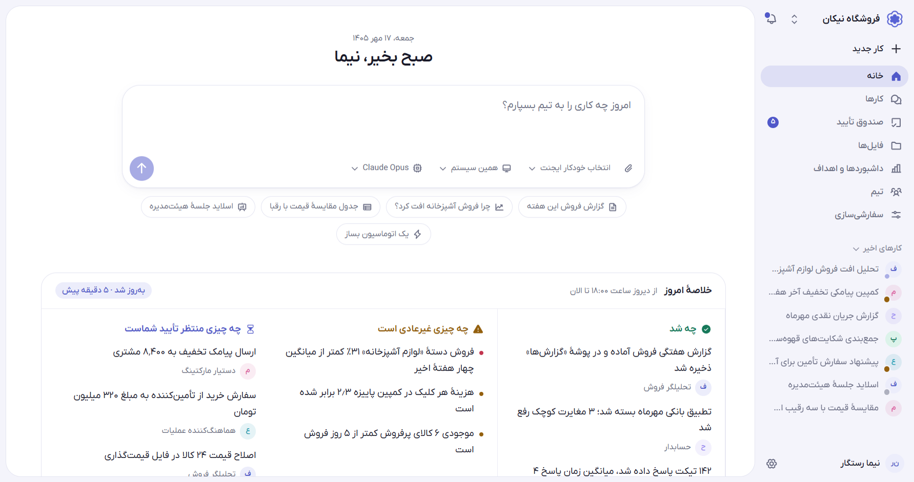
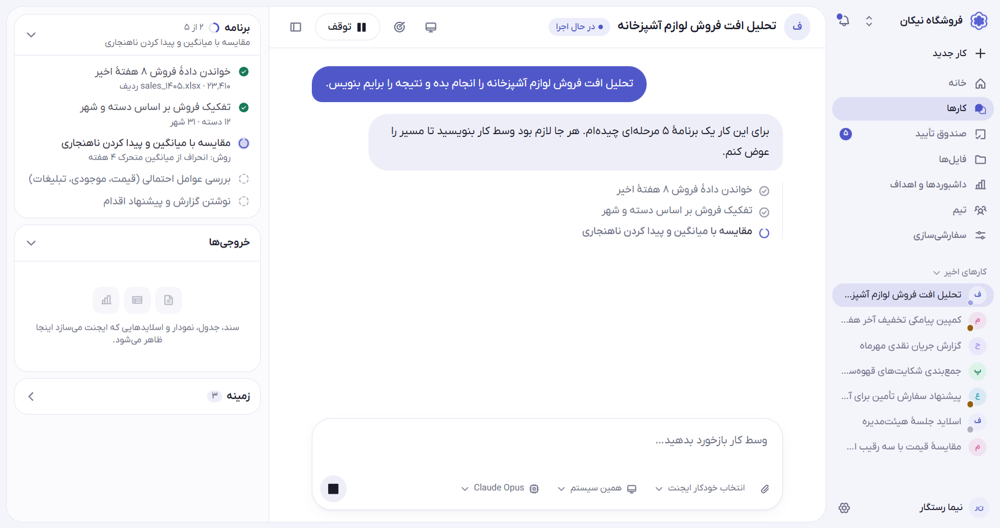
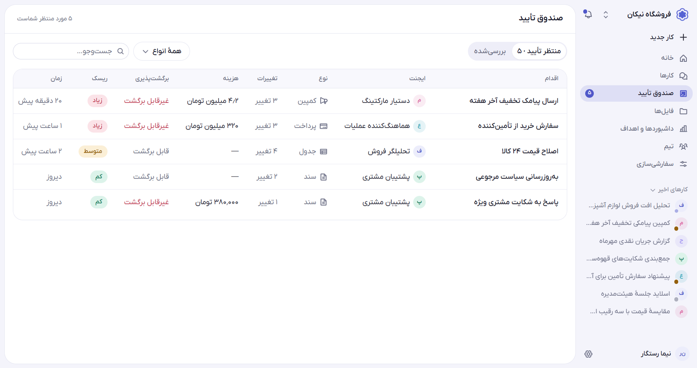
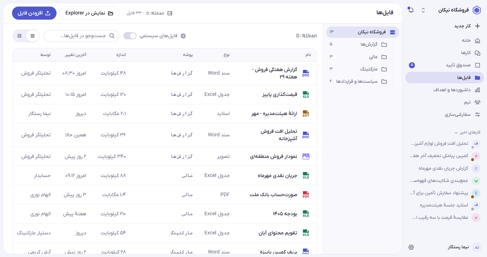
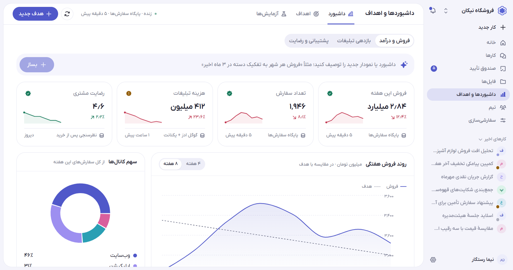
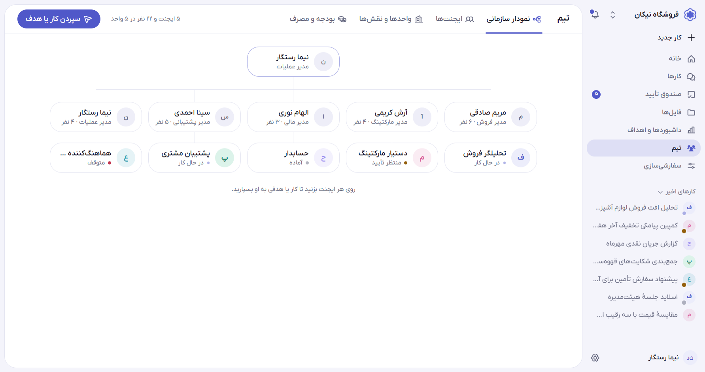
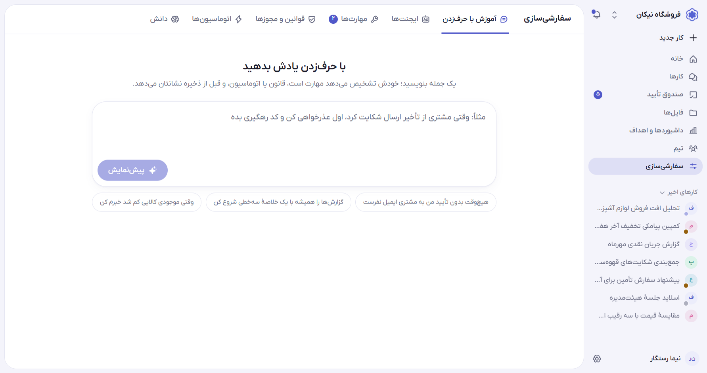
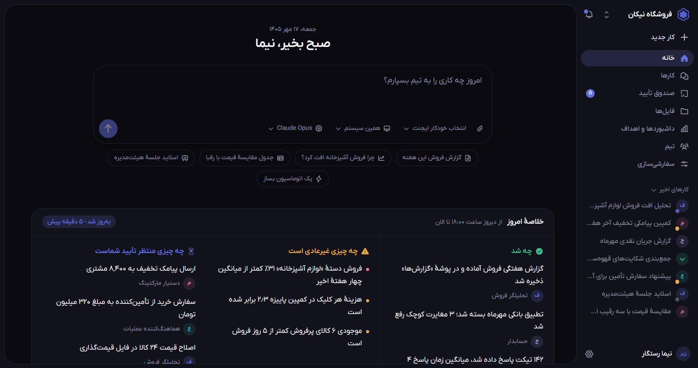
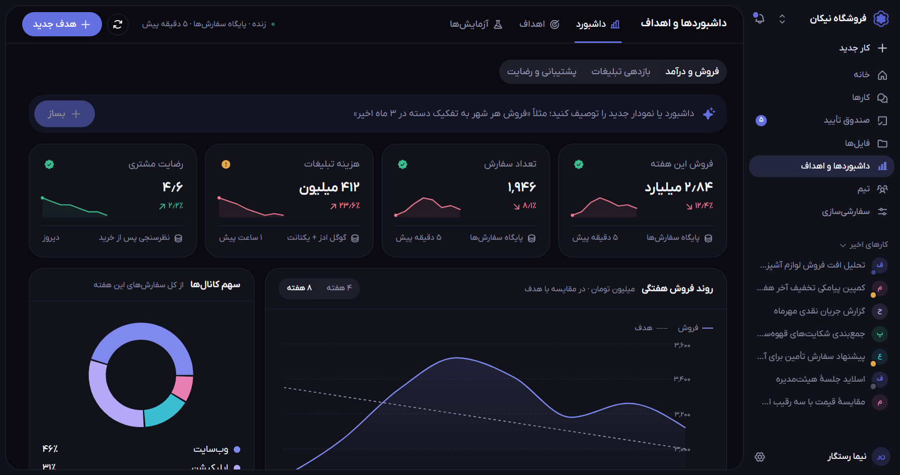

<div align="center">


# Onboard Harness

**سیستم‌عامل کاری تیم شما؛ ایجنت‌ها کار را انجام می‌دهند، شما تصمیم می‌گیرید.**

اپلیکیشن دسکتاپ، فارسی و راست‌به‌چپ، برای تیم‌هایی که برنامه‌نویس نیستند.

</div>

<p align="center">
  
</p>

## Onboard Harness چیست؟

یک پوشه روی سیستم خود انتخاب می‌کنید و همان می‌شود «فضای کاری». ایجنت‌ها داخل همین پوشه فایل می‌خوانند و می‌سازند، گزارش می‌نویسند، داشبورد می‌سازند و کارهای تکراری را انجام می‌دهند. هر کاری که اثر برگشت‌ناپذیر دارد، اول به صندوق تأیید شما می‌رسد.

مثل یک مخزن (repository) است: هر فضای کاری یک پوشه است، همه‌چیز همان‌جا ذخیره می‌شود و پوشهٔ آن بعد از ساخت قابل تغییر نیست.

## فیچرها

### کارها: گفتگو با ایجنت

کار را به زبان ساده بنویسید و ایجنت مناسب را خودکار انتخاب کنید، یا خودتان انتخاب کنید. هر کار یک گفتگوی زنده است:

- برنامهٔ چندمرحله‌ای ایجنت و پیشرفت هر مرحله را می‌بینید.
- وسط کار می‌توانید بازخورد بدهید، کار را متوقف کنید یا مسیر را عوض کنید.
- خروجی‌ها (سند، جدول، نمودار، اسلاید) کنار گفتگو ظاهر می‌شوند.
- مدل زبانی را برای هر گفتگو جدا انتخاب می‌کنید.

<p align="center">
  
</p>

### صندوق تأیید

اقدام‌های حساس، مثل پرداخت، ارسال پیامک به مشتری‌ها یا تغییر قیمت‌ها، بدون تأیید شما اجرا نمی‌شوند. برای هر مورد می‌بینید چه کسی درخواست داده، چند تغییر دارد، هزینه‌اش چقدر است، ریسکش چیست و **قابل برگشت** هست یا نه. می‌توانید تأیید کنید، ویرایش کنید یا رد کنید.

<p align="center">
  
</p>

### فایل‌ها

مرورگر فایل‌های همان پوشهٔ فضای کاری:

- فایل‌های معمولی (Word، Excel، اسلاید، PDF، تصویر) به‌صورت پیش‌فرض نمایش داده می‌شوند و داخل خود برنامه باز و ویرایش می‌شوند.
- فایل‌های سیستمی (داشبورد، ایجنت، مهارت، قانون، اتوماسیون، دانش) با فیلتر «فایل‌های سیستمی» دیده می‌شوند، با رنگ و آیکن جدا.
- نمایش لیستی یا شبکه‌ای.

<p align="center">
  
</p>

### داشبوردها و اهداف

- داشبورد بسازید؛ حتی با توصیف به زبان ساده، مثلاً «فروش هر شهر به تفکیک دسته در ۳ ماه اخیر».
- کارت‌های شاخص با روند، منبع داده و زمان آخرین به‌روزرسانی.
- نمودارهای تعاملی؛ روی یک دسته بزنید تا جدول زیرش فیلتر شود.
- اهداف سازمانی و آزمایش‌ها در همین بخش.

<p align="center">
  
</p>

### تیم

نمودار سازمانی شامل مدیران، واحدها و ایجنت‌ها. وضعیت هر ایجنت (در حال کار، آماده، منتظر تأیید، متوقف) را می‌بینید و با یک کلیک کار یا هدف را به او می‌سپارید. تب‌های جدا برای ایجنت‌ها، واحدها و نقش‌ها، و بودجه و مصرف.

<p align="center">
  
</p>

### سفارشی‌سازی

ایجنت‌ها را با زبان خودتان آموزش بدهید:

- **آموزش با حرف‌زدن:** یک جمله بنویسید؛ خودش تشخیص می‌دهد مهارت است، قانون یا اتوماسیون، و قبل از ذخیره پیش‌نمایش می‌دهد.
- **ایجنت‌ها:** هر ایجنت یک پروفایل مستقل دارد.
- **مهارت‌ها:** روش‌های کاری که ایجنت فقط وقتی لازم شد استفاده می‌کند.
- **قوانین و مجوزها:** چه کاری آزاد است، چه کاری تأیید می‌خواهد و چه کاری ممنوع است.
- **اتوماسیون‌ها** و **دانش** سازمان.
- هر مورد را برای کل سازمان، واحد خودتان یا فقط خودتان فعال کنید.

<p align="center">
  
</p>

### تنظیمات

عمومی (زبان، تقویم شمسی یا میلادی، تومان یا ریال، تم)، اتصال‌ها و پوشه‌ها، دسترسی ایجنت‌ها، مدل‌ها، بودجه و سقف هزینه، اعضا و دسترسی‌ها، و دستگاه‌ها و اجرا (همین سیستم یا ابری).

**مدل‌ها را خودتان تعریف می‌کنید:** نشانی پایه، کلید API و نام مدل. کلیدها در مخزن امن سیستم‌عامل نگه‌داری می‌شوند، نه در پوشهٔ فضای کاری.

### تجربهٔ کاربری

- فارسی و راست‌به‌چپ، با اعداد فارسی و تاریخ شمسی.
- حالت روشن و تیره.
- رابط بزرگ و خوانا، با گوشه‌های گرد و آیکن‌های پررنگ.

<p align="center">
  
  
</p>

## ایمنی و کنترل

- ایجنت فقط داخل پوشهٔ فضای کاری کار می‌کند.
- مجوز هر ابزار «مجاز»، «با تأیید» یا «ممنوع» است.
- سقف تلاش، زمان و هزینه برای هر کار؛ ایجنت از آن عبور نمی‌کند.
- هر گام در یک فایل رویداد ثبت می‌شود تا بعداً قابل بازبینی باشد.
- کار نیمه‌تمام بعد از قطع شدن، از همان‌جا ادامه پیدا می‌کند.
- فرمان‌ها روی سیستم خودتان اجرا می‌شوند، با ایزوله‌سازی سبک.

## دانلود

آخرین نسخه برای ویندوز در صفحهٔ [Releases](https://github.com/TahaHosseinpour/onboard-harness/releases/latest) است:

- `Onboard-Harness-Setup-0.1.0.exe` — نصب‌کننده
- `Onboard-Harness-0.1.0-win-x64.zip` — نسخهٔ بدون نصب؛ از حالت فشرده خارج کنید و `Onboard Harness.exe` را اجرا کنید

برنامه امضای دیجیتال ندارد، برای همین ویندوز بار اول هشدار SmartScreen نشان می‌دهد («More info» و بعد «Run anyway»).

**وضعیت نسخهٔ ۰٫۱٫۰:** این نسخه رابط کاربری را با دادهٔ نمونه نشان می‌دهد. بک‌اند و بخش ایجنتیک در پوشهٔ `backend/` ساخته و تست شده‌اند، ولی هنوز به رابط وصل نیستند و داخل نصب‌کننده هم نیستند؛ فعلاً جدا اجرا می‌شوند.

## تست پذیرش

بک‌اند با یک فهرست ۶۶ موردی (حلقهٔ اجرا، مجوزها، حافظه، مهارت‌ها، پایداری، هزینه و …) با مدل واقعی سنجیده شده است. گزارش کامل در [backend/evals/REPORT.md](backend/evals/REPORT.md) و نتیجهٔ اجرای دوبارهٔ موارد ردشده با مدل‌های DeepSeek در [REPORT.deepseek-retest.md](backend/evals/REPORT.deepseek-retest.md) و [REPORT.deepseek41-retest.md](backend/evals/REPORT.deepseek41-retest.md) است. برای اجرای دوباره:

```bash
cd backend
set HARNESS_EVAL_KEY=کلید-شما
.venv\Scripts\python -m evals.run
```

## اجرا از روی کد

```bash
npm install
npm run dev              # مرورگر، http://localhost:3210
npm run desktop          # پنجرهٔ Electron روی سرور توسعه
npm run desktop:preview  # خروجی ایستا داخل Electron
npm run desktop:build    # ساخت نصب‌کننده و zip ویندوز در release/dist
```

بک‌اند (پوشهٔ `backend/`) جدا اجرا می‌شود و توضیحاتش در [backend/README.md](backend/README.md) است:

```bash
cd backend
python -m venv .venv
.venv\Scripts\pip install -e ".[dev]"
.venv\Scripts\python -m server        # http://127.0.0.1:8765
```

## فونت

رابط با **IRANYekanX (FaNum)** نوشته شده. این فونت مجوز دارد و داخل مخزن نیست؛ آن را روی سیستم خود نصب کنید تا برنامه از آن استفاده کند. بدون آن، از Vazirmatn، Segoe UI یا Tahoma استفاده می‌شود.

## فناوری‌ها

Next.js 16، React 19، Tailwind CSS v4، Radix UI، آیکن‌های Phosphor، zustand، Recharts، Tiptap، AG Grid، Electron. بک‌اند: Python، FastAPI، deepagents، LangGraph و SQLite.
